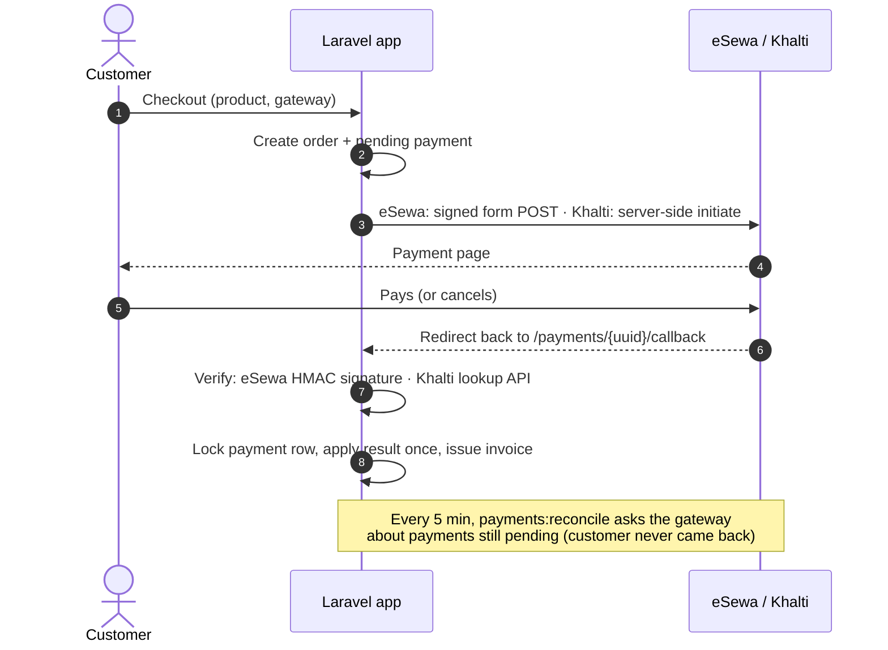

# Laravel Nepal Payments

[](https://github.com/Schaulagain/laravel-nepal-payments/actions/workflows/tests.yml)

A Laravel 13 demo store that takes payments through **eSewa** and **Khalti**, built around the part of payment systems that's easy to get wrong: **never trusting what comes back from the browser**.

It recreates, from scratch and with public sandbox credentials, the kind of payment service I built and owned at work for a cloud self-service portal: one payment layer that every product purchase goes through, with transaction records, gateway callbacks, verification and invoices.

## The payment flow



## What it handles

- **Signature verification (eSewa).** Callback data is base64 JSON signed with HMAC-SHA256. The app re-computes the signature over the fields eSewa lists, compares it in constant time, and rejects callbacks that don't sign the status and amount. Tested against eSewa's own documentation example, and confirmed against the live sandbox, which accepts the app's signatures and rejects tampered ones (`ES104 Invalid payload signature`).
- **Server-side confirmation (Khalti).** Khalti's callback isn't signed, so the app only trusts its lookup API, as Khalti recommends.
- **Callbacks tied to their payment.** A validly signed callback for payment A can't be replayed against payment B.
- **Amount checks.** If the gateway reports a different amount from the order, the payment is failed, not completed.
- **Idempotency.** The payment row is locked during processing, final states never change, and a unique index makes a second invoice for the same payment impossible, so refreshes, retries and reconciliation can safely overlap.
- **Reconciliation.** `php artisan payments:reconcile` (scheduled every five minutes) asks each gateway about payments still pending, covering customers who close the tab before returning. Gateway outages leave payments pending for the next run.
- **Money as integers.** Amounts are stored in paisa and converted only at the gateway boundary.

### A gateway quirk worth knowing

eSewa signs `total_amount` as it appears in its JSON, e.g. `1000.0`. PHP's `json_decode()` turns that into a float that prints as `1000`, so a naive check rejects every real payment with a round amount. The gateway re-encodes floats with `JSON_PRESERVE_ZERO_FRACTION` before verifying, and a test pins this against eSewa's published example.

## Code tour

| Path | What's there |
| --- | --- |
| `app/Payments/Contracts/PaymentGateway.php` | The interface every gateway implements: `checkout`, `handleCallback`, `fetchStatus` |
| `app/Payments/Gateways/EsewaGateway.php` | eSewa ePay v2: signing, callback verification, status API |
| `app/Payments/Gateways/KhaltiGateway.php` | Khalti KPG-2: initiate, lookup, status mapping |
| `app/Payments/PaymentProcessor.php` | Applies a verified result exactly once and issues the invoice |
| `app/Console/Commands/ReconcilePayments.php` | Re-checks stale pending payments |
| `tests/Feature/` | 20 tests, with HTTP calls to both gateways faked |

Adding another gateway (for example a bank gateway) means one new class implementing `PaymentGateway`, registered in `GatewayManager`.

## Running it

Requires PHP 8.4+ and Composer.

```sh
composer install
cp .env.example .env && php artisan key:generate
php artisan migrate --seed
php artisan serve
```

- **eSewa** works out of the box with its public sandbox credentials. Test accounts are listed in the [eSewa developer docs](https://developer.esewa.com.np/).
- **Khalti** needs a free sandbox merchant account at [test-admin.khalti.com](https://test-admin.khalti.com); put its secret key in `KHALTI_SECRET_KEY`. Test accounts are in the [Khalti docs](https://docs.khalti.com/khalti-epayment/).
- Gateways redirect back to `APP_URL`. When testing on your own machine, set `APP_URL=http://localhost:8000`.

```sh
php artisan test               # run the test suite
php artisan payments:reconcile # check pending payments now
```

## Not included (yet)

- Authentication and an admin dashboard for payments
- Refund requests through the gateway APIs
- Webhooks, for gateways that offer them
