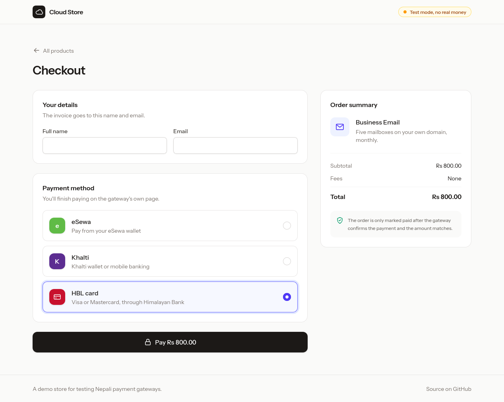
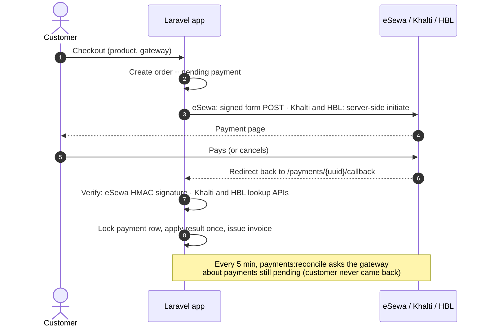

# Laravel Nepal Payments

[](https://github.com/Schaulagain/laravel-nepal-payments/actions/workflows/tests.yml)

A small Laravel 13 store that takes payments through eSewa, Khalti and HBL (Himalayan Bank) cards.

At my last job I looked after the payment service for a cloud portal. Every purchase went through it: VPS, domains, email and so on. This repo rebuilds the core of that idea from scratch, using the gateways' public docs and sandboxes, so I have something I can actually show.



The main rule the code follows: the browser redirect back from the gateway is never enough to mark a payment as paid. The app checks with the gateway first.

## Flow



## How payments are checked

eSewa sends the result back as base64 JSON with an HMAC-SHA256 signature. The app signs the same fields again with the secret key and compares the two with `hash_equals`. If the callback doesn't include the status and amount in its signed fields, it's rejected. I checked the signing code against the example in eSewa's docs and against the live sandbox. The sandbox accepts the app's signatures and rejects a tampered one with `ES104 Invalid payload signature`.

Khalti's callback isn't signed, so the app ignores everything in it except the `pidx` and asks Khalti's lookup API what really happened. Khalti's docs recommend doing this.

HBL is the most involved. Its card gateway runs on 2C2P's PACO platform, and every message in both directions is a JOSE token: the JSON is signed with PS256 and the result is encrypted with RSA-OAEP and A128CBC-HS256. The app signs with its own private key and encrypts with the bank's public key, and does the reverse for responses. It also checks that a response was issued by `PacoIssuer` for our API key and hasn't expired. The customer is sent to HBL's hosted card page, so card numbers never touch this app.

When the customer comes back, or HBL's server posts its backend notification to `/payments/hbl/notify`, the app doesn't take either at its word. It asks HBL's `transactionList` inquiry API for the order, which gives both the status and the amount.

Some other checks:

- A callback is tied to one payment. A valid eSewa response for payment A can't be replayed against payment B.
- If the gateway reports a different amount from the order, the payment is marked failed.
- The payment row is locked (`lockForUpdate`) while a result is applied, a finished payment never changes again, and `invoices.payment_id` is unique. So a page refresh, a retry and the reconcile job can all hit the same payment without creating two invoices.
- Amounts are stored as integers in paisa and only converted to rupees when talking to a gateway.

If a customer pays and then closes the tab, the app never gets the redirect. `php artisan payments:reconcile` runs every five minutes, picks up payments that have been pending for more than 15 minutes, and asks the gateway for their status. If the gateway is down, the payment just stays pending until the next run.

### The `1000.0` problem

eSewa signs `total_amount` exactly as it appears in its JSON, for example `1000.0`. After `json_decode()`, PHP turns that into a float, and the float prints as `1000`. The signature then doesn't match, so every round-number payment would fail verification. The fix is to re-encode the value with `JSON_PRESERVE_ZERO_FRACTION` before signing. There's a test for this using the example from eSewa's docs.

A few third-party eSewa packages quote a signature for that same example that doesn't match eSewa's own docs. Trust the official one.

### JOSE without a JOSE library

The usual PHP library for this, `web-token/jwt-library`, does RSA maths in plain PHP when the GMP extension is missing, and one signature can take minutes. `app/Payments/Jose/JoseEnvelope.php` does the same job with PHP's built-in OpenSSL functions instead. RSA-OAEP and AES-CBC are built into OpenSSL. For PS256, the PSS padding is a few lines of PHP around OpenSSL's raw RSA operation. Its output was checked against the Node `jose` package in both directions, with 2048 and 4096-bit keys.

## Where things are

| Path | |
| --- | --- |
| `app/Payments/Contracts/PaymentGateway.php` | Interface for gateways: `checkout`, `handleCallback`, `fetchStatus` |
| `app/Payments/Gateways/EsewaGateway.php` | eSewa ePay v2: signing, callback check, status API |
| `app/Payments/Gateways/KhaltiGateway.php` | Khalti: initiate, lookup, status mapping |
| `app/Payments/Gateways/HblGateway.php` | HBL cards: payment page, inquiry, backend notification |
| `app/Payments/Jose/JoseEnvelope.php` | Signs and encrypts HBL's JOSE tokens, and opens them |
| `app/Payments/PaymentProcessor.php` | Applies a checked result once and creates the invoice |
| `app/Console/Commands/ReconcilePayments.php` | Re-checks old pending payments |
| `tests/Feature/` | 32 tests. Gateway HTTP calls are faked, and the HBL tests play the bank's side with their own keys |

To add another gateway, write a class that implements `PaymentGateway` and register it in `GatewayManager`.

## Running it

You need PHP 8.4 or newer, Composer and Node.

```sh
composer install
npm install && npm run build
cp .env.example .env && php artisan key:generate
php artisan migrate --seed
php artisan serve
```

A gateway only shows up at checkout once its keys are set.

eSewa works straight away with its public sandbox keys. The test login details are in the [eSewa developer docs](https://developer.esewa.com.np/).

Khalti needs a free sandbox merchant account from [test-admin.khalti.com](https://test-admin.khalti.com). Put the secret key in `KHALTI_SECRET_KEY`. Test accounts are listed in the [Khalti docs](https://docs.khalti.com/khalti-epayment/).

HBL has no public sandbox. You get the office ID, API key, key ID and the bank's two public keys when you sign up as a merchant. You also make two RSA key pairs of your own (one for signing, one for encryption) and send HBL the public halves. All of these go in the `HBL_*` variables in `.env`. The backend notification URL (`/payments/hbl/notify`) has to be registered with the bank. Because I don't have merchant credentials, the HBL code is tested against HBL's published request format and 2C2P's API reference rather than a live payment.

The gateways redirect back to `APP_URL`, so set `APP_URL=http://localhost:8000` when running locally.

```sh
php artisan test
php artisan payments:reconcile
```

## Not done yet

- Login and an admin page for payments
- Refunds through the gateway APIs
- Webhooks
